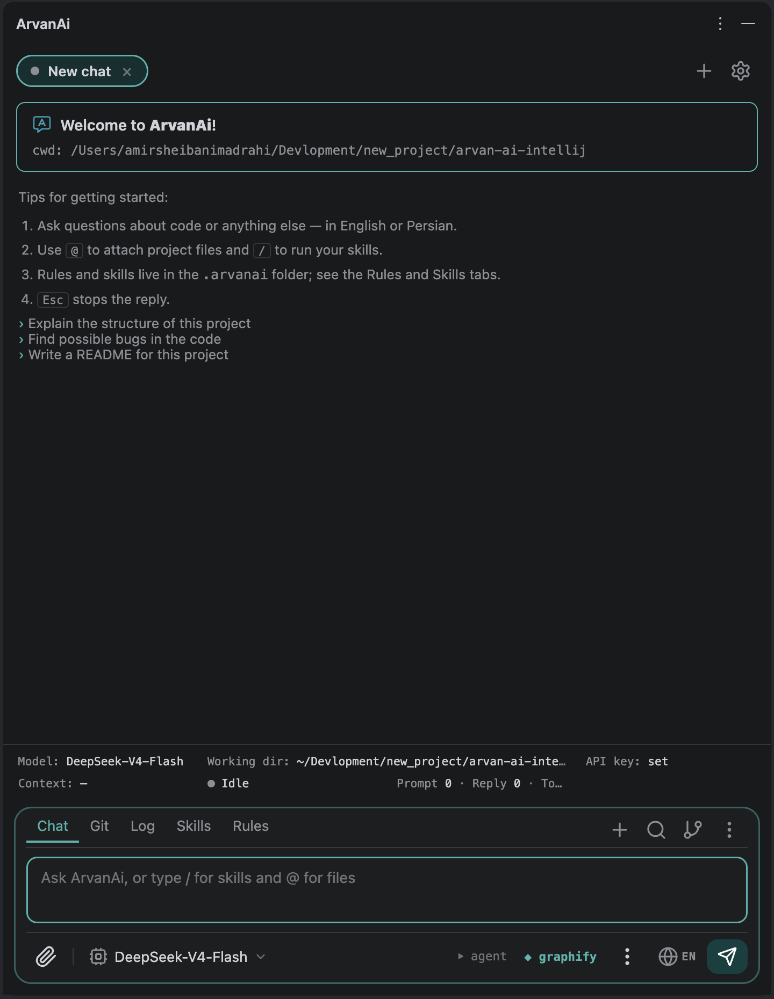
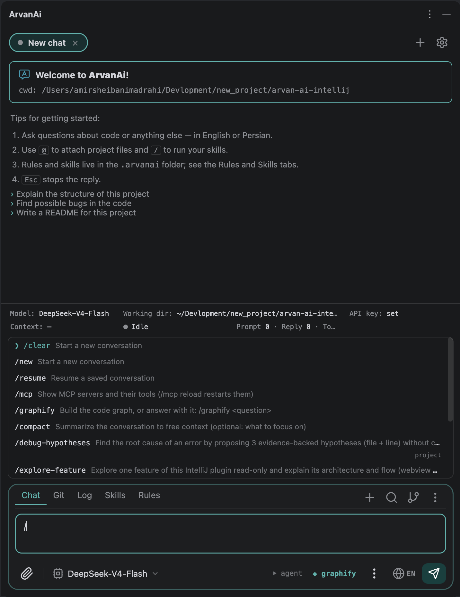

# ArvanAi for JetBrains IDEs

**An AI coding agent and chat panel for IntelliJ IDEA, Android Studio, PyCharm, WebStorm and other JetBrains IDEs, powered by ArvanCloud AI, with correct Persian / right-to-left (RTL) text.**

It connects to the [ArvanCloud](https://www.arvancloud.ir) AI Gateway (`api.arvancloudai.ir`), an OpenAI-compatible API.

[فارسی](README.md) · [Download the latest release](https://github.com/amirsheibani/arvan-ai-intellij/releases/latest)



## Why

JetBrains terminals and most AI plugins break Persian text: letters are shown separated and in reverse order, and mixed Persian/English lines are scrambled. This plugin renders the chat in an embedded browser (JCEF) with proper bidi support, so Persian, English and code all display correctly.

## Features

**Chat**
- Direct connection to ArvanCloud's OpenAI-compatible API (`/v1/chat/completions`) with live streaming
- Live model list from your gateway (`GET /v1/models`) with a searchable model menu
- Multiple chats, auto-save, and `/resume`
- RTL panel with the Vazirmatn font; each paragraph detects its own direction, code and paths always stay LTR
- Copy and Insert-into-editor buttons on every code block; the current file/selection is sent as context



**Coding agent**
- Read, search, edit files and run commands, with your approval and a diff in the IDE's own Diff Viewer
- Code navigation through the IDE index (`find_symbol`, `file_outline`, `find_references`, `go_to_definition`, `file_relations`), no external tools needed
- Plan mode, task list, automatic context compaction, and MCP servers
- Optional code graph with `/graphify`

**Project rules and security**
- Project rules and skills from `.arvanai/` (rules go into the system prompt, skills run as `/name`)
- One-click import of rules from other tools into `.arvanai/`, without touching the originals
- Does not read or modify files of Claude Code, Cursor, Copilot and others (`AGENTS.md`, `CLAUDE.md`, `.claude/`, `.mcp.json`, `.git/hooks`)
- The API key is stored in the IDE's Password Safe, never in settings files or logs

## Architecture

The UI is an embedded JCEF browser; messages flow between it and the Kotlin layers:

```
        Chat panel (webview: chat.html / chat.js / chat.css)
        chat, streaming, RTL, code insert, model menu
                        │
                        │ post(kind, payload)  /  handleFromJs
                        ▼
              ChatPanel.kt  (JS ↔ Kotlin bridge)
              validates messages, dispatches to services
                        │
        ┌───────────────┼───────────────────────────┐
        ▼               ▼                           ▼
  ArvanClient.kt   AgentTools / CodeTools      SlashCommands
  HTTP + SSE       file edits (WriteCommand    /resume, /plan,
  streaming,       on EDT), commands, IDE      /graphify …
  model list       index search, MCP
                        │
                        ▼
        ArvanCloud API (api.arvancloudai.ir/v1)
```

Layering rules: no I/O or network on the EDT (`executeOnPooledThread`), file edits only through `WriteCommandAction` on the EDT, and no secrets or user text injected into HTML — only JSON.

## Install

1. Create an API key in the ArvanCloud AI Gateway (see the [getting-started guide](docs/getting-started.md), in Persian).
2. Download `arvan-ai-intellij-<version>.zip` from [Releases](https://github.com/amirsheibani/arvan-ai-intellij/releases/latest).
3. In the IDE: **Settings › Plugins › ⚙ › Install Plugin from Disk…** and choose the zip.
4. Open **Settings › Tools › ArvanAi** and paste your key.

Requires a JetBrains IDE 2024.2 or newer.

## Build from source

```bash
./gradlew buildPlugin   # needs JDK 21; output: build/distributions/
./gradlew runIde        # run a sandbox IDE with the plugin
```

## Tech stack

Kotlin · IntelliJ Platform SDK · JCEF (embedded Chromium) · Server-Sent Events · MCP · Gradle
