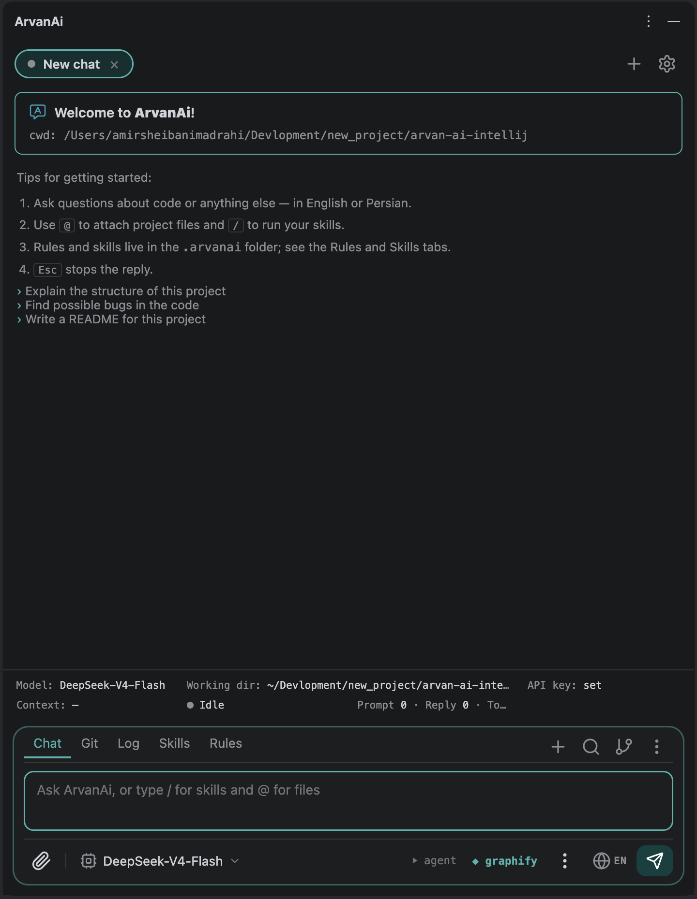
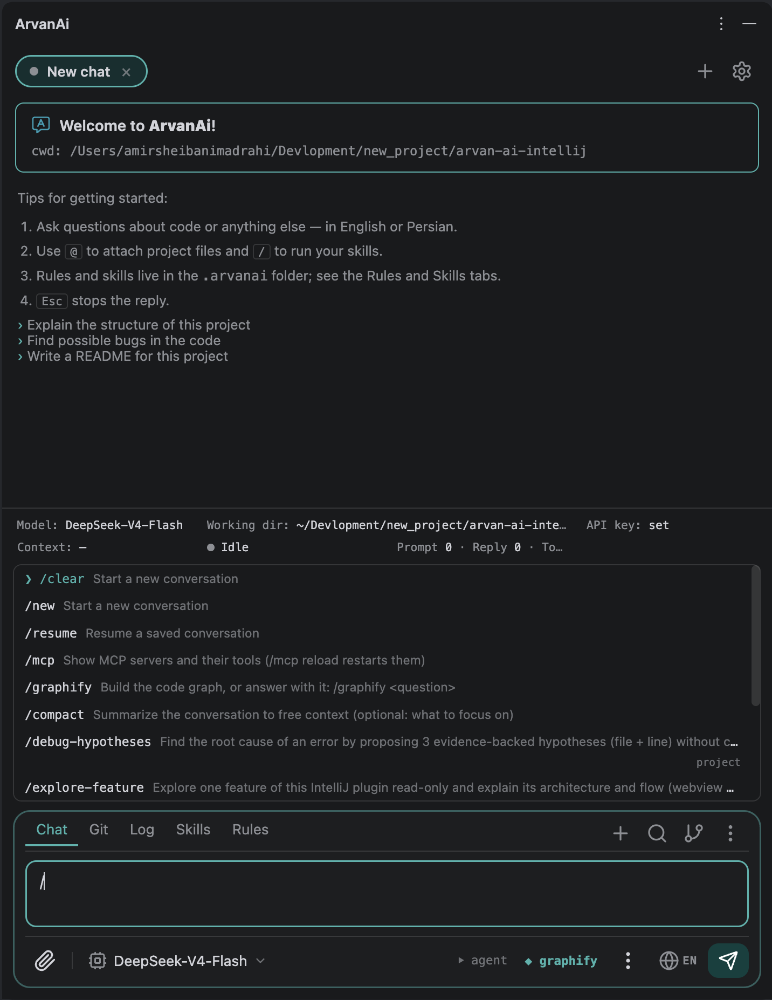

# ArvanAi — دستیار و ایجنت هوش مصنوعی ابرآروان داخل IDEهای JetBrains

یک پنل گفتگو و ایجنت برنامه‌نویسی که با مدل‌های **هوش مصنوعی ابرآروان** (`api.arvancloudai.ir`) کار می‌کند. داخل IntelliJ IDEA، PyCharm، WebStorm، Android Studio و بقیهٔ IDEهای JetBrains اجرا می‌شود و متن فارسی، راست‌به‌چپ و متن‌های ترکیبی فارسی/انگلیسی را درست نشان می‌دهد.



**اولین بار است؟** از [راهنمای شروع](docs/getting-started.md) شروع کنید. ساخت سرویس در ابرآروان، نصب، تنظیم و اولین گفتگو را قدم‌به‌قدم توضیح می‌دهد.

## امکانات

**گفتگو**
- اتصال مستقیم به API سازگار با OpenAI ابرآروان (`/v1/chat/completions`) با نمایش زندهٔ پاسخ (streaming)
- **فهرست مدل‌ها از خود ابرآروان:** دکمهٔ «دریافت مدل‌ها» در Settings و منوی مدل با جستجو در پنل چت (`GET /v1/models`)
- چند گفتگوی هم‌زمان، ذخیرهٔ خودکار و ادامهٔ گفتگو با `/resume`
- پنل راست‌به‌چپ با فونت **وزیرمتن**. هر پاراگراف جهت خودش را تشخیص می‌دهد و کد و مسیرها همیشه LTR می‌مانند.
- دکمه‌های **کپی** و **درج در ویرایشگر** برای هر بلوک کد، و ارسال خودکار فایل/انتخاب فعلی ویرایشگر



**ایجنت برنامه‌نویسی**
- خواندن، جستجو، ویرایش فایل و اجرای دستور، با تأیید شما و diff در Diff Viewer خود IDE
- **پیمایش کد با index خود IDE:** `find_symbol`، `file_outline`، `find_references`، `go_to_definition` و `file_relations`، بدون ابزار خارجی
- حالت طرح (plan mode)، فهرست کارها، خلاصه‌سازی خودکار context، و سرورهای MCP
- **graphify اختیاری:** `/graphify` گراف کد را در پوشهٔ خود IDE می‌سازد و `/graphify <سؤال>` با آن پاسخ می‌دهد

**پروژه و امنیت**
- **قوانین و اسکیل‌های پروژه** از `.arvanai/`: قوانین به system prompt اضافه می‌شوند و اسکیل‌ها با `/نام` اجرا می‌شوند
- دکمهٔ **«کپی قوانین و اسکیل‌ها»** قوانین ابزارهای دیگر را در `.arvanai/` کپی می‌کند و فایل‌های اصلی دست نمی‌خورند
- **بدون تداخل با ابزارهای دیگر:** فایل‌های Claude Code، Cursor، Copilot و بقیه (`AGENTS.md`، `CLAUDE.md`، `.claude/`، `.mcp.json`، `graphify-out/`، `.git/hooks`) را نمی‌خواند و تغییر نمی‌دهد
- کلید API در Password Safe خود IDE ذخیره می‌شود، نه در فایل تنظیمات یا لاگ

## نحوهٔ کار (معماری)

پلاگین از یک **مرورگر داخلی JCEF** به‌عنوان رابط کاربری استفاده می‌کند و گفتگو در یک فلو رفت‌وبرگشتی بین آن و لایه‌های پشتیبان جریان دارد:

```
        پنل چت (webview: chat.html / chat.js / chat.css)
        گفتگو، استریم پاسخ، RTL، درج کد، منوی مدل
                        │
                        │ post(kind, payload)  /  handleFromJs
                        ▼
              ChatPanel.kt  (پل JS ↔ Kotlin)
              اعتبارسنجی پیام‌ها، dispatch به سرویس‌ها
                        │
        ┌───────────────┼───────────────────────────┐
        ▼               ▼                           ▼
  ArvanClient.kt   AgentTools / CodeTools      SlashCommands
  HTTP + SSE       ویرایش فایل (WriteCommand   /resume، /plan،
  استریم پاسخ و    روی EDT)، اجرای دستور،       /graphify و …
  فهرست مدل‌ها     جستجوی index IDE، MCP
                        │
                        ▼
        API ابرآروان (api.arvancloudai.ir/v1)
```

لایه‌ها از بالا به پایین:

| لایه | فایل‌ها | نقش |
|---|---|---|
| Webview | `src/main/resources/webview/*` | رابط گفتگو: markdown، استریم زنده، RTL با فونت وزیرمتن، دکمه‌های کپی/درج |
| پل | `ui/ChatPanel.kt` | JCEF browser؛ ترجمهٔ پیام‌های JS به Kotlin (`handleFromJs`) و برعکس (`post`)؛ متن فقط به‌صورت JSON فرستاده می‌شود |
| API | `api/ArvanClient.kt` | درخواست chat/completions با استریم SSE، مدیریت خطاها، `GET /v1/models` |
| ایجنت | `agent/`، `mcp/`، `ide/` | ابزارهای خواندن/جستجو/ویرایش/اجرای دستور، پیمایش index IDE، git، graphify، سرورهای MCP |
| گفتگو | `chat/` | مدیریت گفتگوها، پرامپت‌ها، ذخیرهٔ خودکار |
| قوانین | `context/` | خواندن `.arvanai/` و افزودن به system prompt، دکمهٔ کپی قوانین |
| تنظیمات | `settings/` | GUI تنظیمات + ذخیرهٔ کلید API در Password Safe |
| اکشن‌ها | `actions/` | دستورهای منو (مثلاً ارسال انتخاب به چت، کپی قوانین) |

قواعد لایه‌بندی: هیچ I/O یا شبکه‌ای روی EDT اجرا نمی‌شود (با `executeOnPooledThread`)، ویرایش فایل‌ها فقط با `WriteCommandAction` روی EDT انجام می‌شود، و هیچ راز یا محتوای گفتهٔ کاربر مستقیماً داخل HTML تزریق نمی‌شود — فقط JSON.

## پیش‌نیاز
1. یک **کلید API** از AI Gateway ابرآروان. روش ساختش در [راهنمای شروع](docs/getting-started.md#۱-ساخت-سرویس-در-ابرآروان) آمده است.
2. IDE نسخهٔ 2024.2 یا جدیدتر
3. JDK 21، فقط برای build از سورس

## ساخت و نصب
```bash
JAVA_HOME="/Applications/IntelliJ IDEA CE.app/Contents/jbr/Contents/Home" ./gradlew buildPlugin
```
فایل `build/distributions/arvan-ai-intellij-0.2.0.zip` ساخته می‌شود. در IDE به **Settings › Plugins › ⚙ › Install Plugin from Disk…** بروید و همان zip را انتخاب کنید.

برای اجرای یک IDE آزمایشی همراه با پلاگین:
```bash
./gradlew runIde
```

## تنظیمات
**Settings › Tools › ArvanAi**

| تنظیم | پیش‌فرض | توضیح |
|---|---|---|
| API key | — | در Password Safe ذخیره می‌شود و با هدر `Authorization: apikey <key>` فرستاده می‌شود |
| Base URL | `https://api.arvancloudai.ir/v1` | |
| Model + «دریافت مدل‌ها» | `GPT-5.2-Pro` | فهرست مدل‌های چتی که gateway شما در دسترس گذاشته است |
| Max completion tokens | `8000` | |
| Streaming | روشن | |
| HTTP proxy | — | مثلاً `http://127.0.0.1:10809` |
| ابزارهای ایجنت | روشن | خواندن، جستجو، ویرایش و اجرای دستور |
| اعمال ویرایش / اجرای دستور بدون پرسیدن | خاموش | |
| MCP | روشن | از `.arvanai/mcp.json` و `~/.arvanai/mcp.json` |
| حداکثر گام در هر پیام | `40` | |
| بودجهٔ context | `100000` توکن | خلاصه‌سازی خودکار از ۶۰٪ |
| گراف کد (graphify) | — | دکمهٔ ساخت گراف؛ همان کار `/graphify` |

## قوانین و اسکیل‌ها (`.arvanai/`)
```
.arvanai/
  AGENTS.md                 دستورالعمل اصلی پروژه برای ArvanAi
  rules/**/*.md             قوانین (همیشه به system prompt اضافه می‌شوند)
  skills/<name>/SKILL.md    اسکیل‌ها؛ با /<name> آرگومان‌ها اجرا می‌شوند ($ARGUMENTS)
  commands/**/*.md          دستورهای ساده؛ با /<name>
  mcp.json                  سرورهای MCP پروژه
```
معادل سطح کاربر در `~/.arvanai/` است. جزئیات: [docs/instructions-import.md](docs/instructions-import.md)

## مستندات
| سند | موضوع |
|---|---|
| [docs/getting-started.md](docs/getting-started.md) | راهنمای شروع: ساخت سرویس در ابرآروان، نصب، تنظیم، اولین گفتگو |
| [docs/chat-agent.md](docs/chat-agent.md) | ایجنت چت: ابزارها، پیمایش کد، graphify، حالت طرح، MCP |
| [docs/arvan-api.md](docs/arvan-api.md) | ارتباط با API ابرآروان: درخواست، استریم، خطاها، فهرست مدل‌ها |
| [docs/instructions-import.md](docs/instructions-import.md) | قوانین و اسکیل‌های `.arvanai/` و دکمهٔ کپی |

## ساختار پروژه
```
src/main/kotlin/ir/arvanai/
  api/ArvanClient.kt            HTTP به ابرآروان، استریم SSE، فهرست مدل‌ها
  agent/                        ابزارهای ایجنت (AgentTools) و پیمایش کد با index IDE (CodeTools)
  chat/                         گفتگو، پرامپت‌ها، ذخیرهٔ گفتگوها
  context/                      قوانین/اسکیل‌های .arvanai و کپی‌کننده
  mcp/                          کلاینت و مدیریت سرورهای MCP
  ide/                          انتخاب ویرایشگر، جستجوی فایل، git، graphify
  ui/ChatPanel.kt               JCEF browser + پل JS ↔ Kotlin
  settings/                     تنظیمات + ذخیرهٔ کلید در Password Safe
  actions/                      اکشن‌های منو
src/main/resources/webview/
  chat.html / chat.css / chat.js  رابط گفتگو (markdown، RTL، استریم)
  Vazirmatn.woff2                 فونت (مجوز OFL)
```